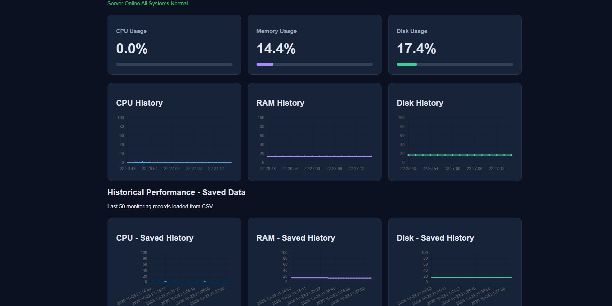
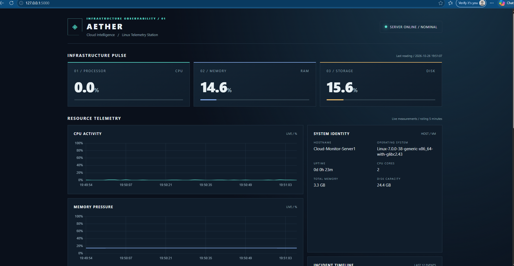
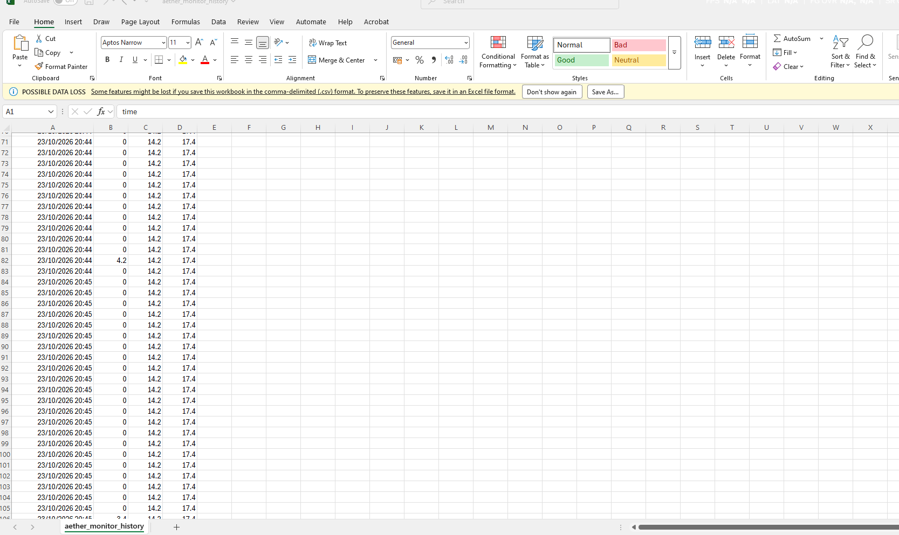
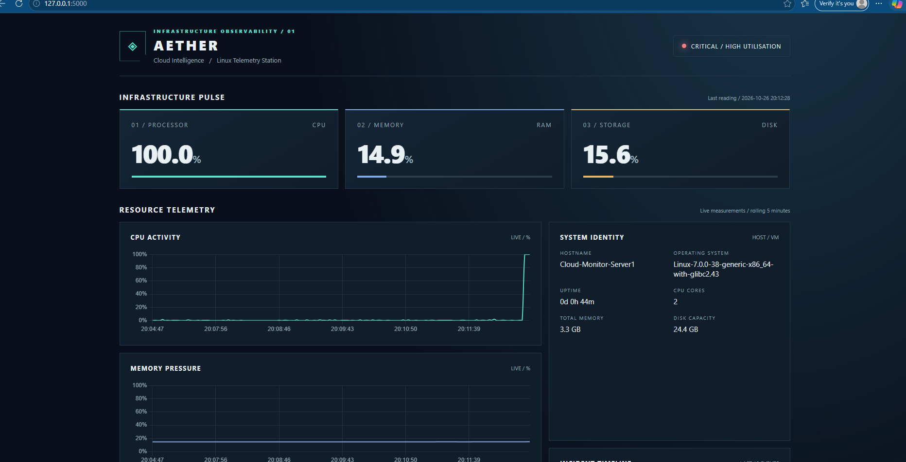
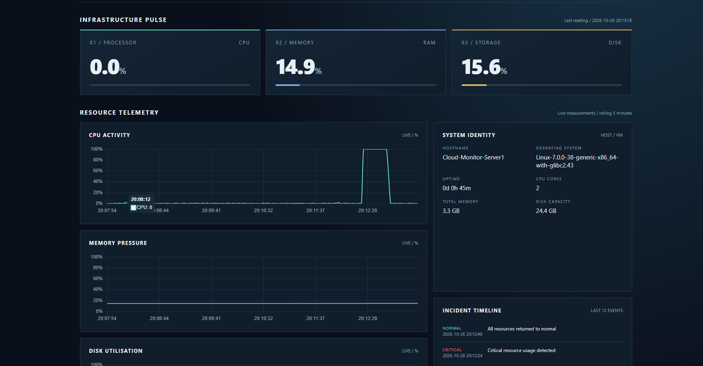
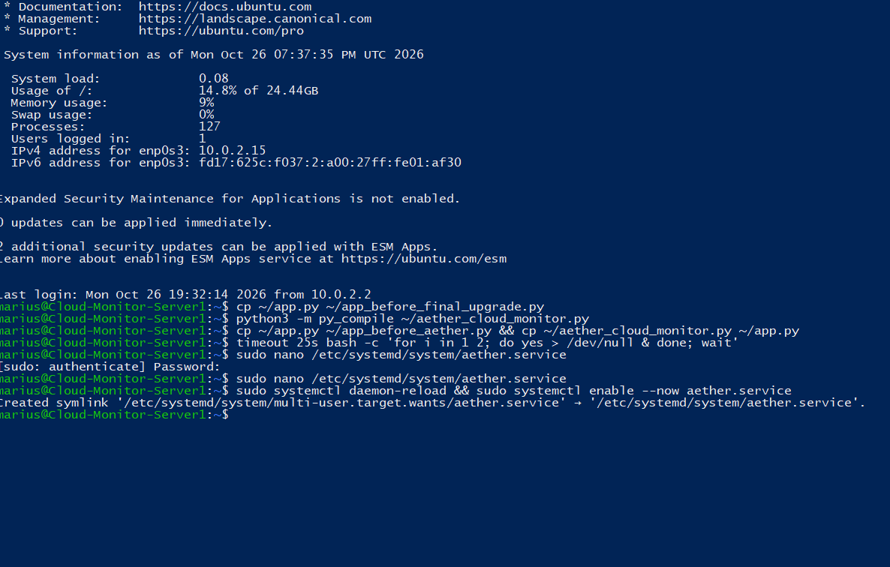
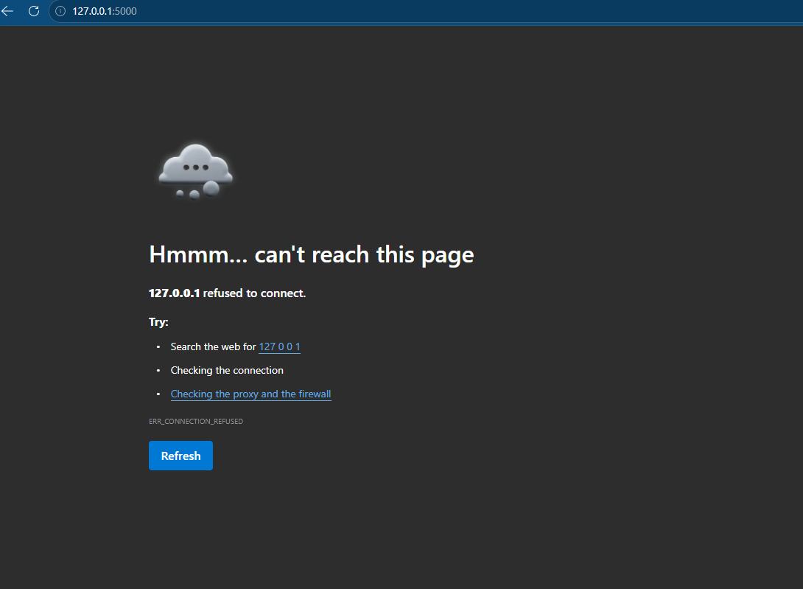
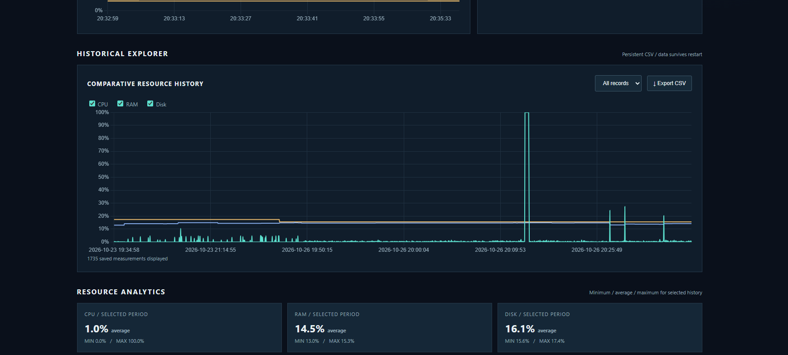
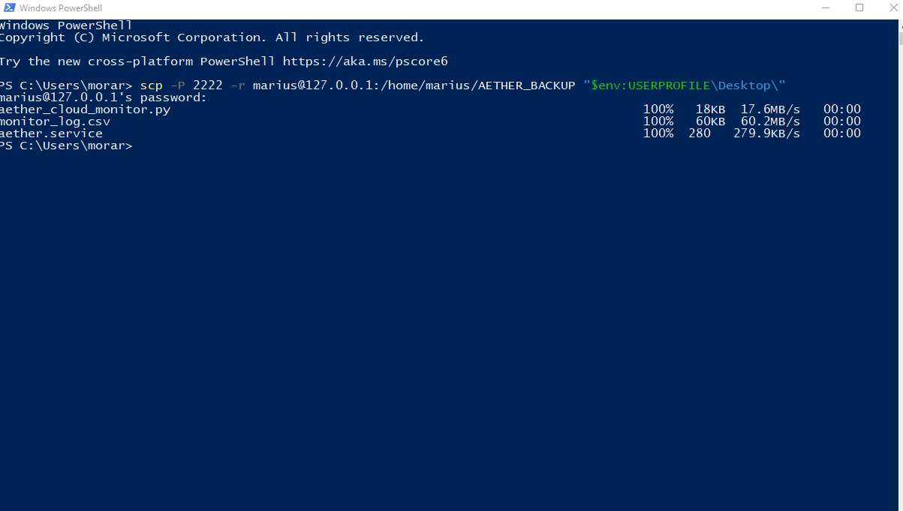

# AETHER – Cloud Intelligence
### Linux Server Monitoring & Resource Analytics Dashboard

AETHER is a Python-based server monitoring application developed as part of my Computing studies. It provides real-time resource monitoring, historical performance analysis, automated alerts and a responsive web dashboard.

The project demonstrates practical skills in Linux system administration, Python programming, API development, troubleshooting and infrastructure monitoring.

## Features

- Real-time CPU, RAM and disk utilisation monitoring
- Interactive performance charts using Chart.js
- Historical data collection and CSV persistence
- Historical performance analysis with minimum, average and maximum values
- Resource utilisation warnings and critical alerts
- Incident timeline and recovery notifications
- Automatic detection of lost server connections
- CSV data export
- System information and uptime monitoring
- Automatic application startup using systemd

## Technology Stack

| Component | Technology |
|---|---|
| Operating system | Ubuntu Linux |
| Virtualisation | Oracle VirtualBox |
| Backend | Python, Flask |
| System metrics | psutil |
| Frontend | HTML, CSS, JavaScript |
| Visualisation | Chart.js |
| Data storage | CSV |
| Remote administration | SSH |
| Service management | systemd |

## Architecture

```text
Ubuntu Virtual Machine
        |
        v
Python + psutil
        |
        v
Resource Data Collection
        |
        +----> CSV Historical Storage
        |
        v
Flask REST API
        |
        v
Web Dashboard
        |
        +----> Live Resource Charts
        +----> Historical Analytics
        +----> Warning / Critical Alerts
        +----> Incident Timeline
        +----> CSV Export
```

## How It Works

AETHER uses psutil to collect CPU, memory and disk utilisation measurements from the Ubuntu server.

A Flask backend provides monitoring information through HTTP API endpoints. The frontend retrieves this data and displays it using interactive charts and resource cards.

Measurements are stored in a CSV file to support historical analysis and preserve performance records across application restarts.

Resource utilisation thresholds are used to identify unusually high system load. The dashboard displays warning or critical conditions and records changes in system status.

## Running the Application

### 1. Clone the repository

```bash
git clone https://github.com/MauM111/AETHER-Cloud-Monitor.git
cd AETHER-Cloud-Monitor
```

### 2. Create a Python virtual environment

```bash
python3 -m venv venv
source venv/bin/activate
```

### 3. Install dependencies

```bash
pip install -r requirements.txt
```

### 4. Start AETHER

```bash
python3 aether_cloud_monitor.py
```

### 5. Open the dashboard

Visit:

```text
http://127.0.0.1:5000
```

The application runs locally by default. When running inside a virtual machine, additional SSH tunnelling or port-forwarding configuration may be required.

The Flask development server is intended for development and demonstration, not direct exposure to the public internet.

## Screenshots

| Screenshot | What it shows |
|---|---|
|  | Initial prototype: live CPU, RAM and disk values with saved history |
|  | Upgraded AETHER dashboard at baseline (server online / nominal) |
|  | Monitoring history exported to CSV and opened in Excel |
|  | CPU load test: 100% utilisation and a CRITICAL status |
|  | After the load ended: CPU graph shows the spike and the return to normal |
|  | Linux terminal: service and application checks |
|  | Connectivity failure test with the service interrupted |
|  | Historical explorer showing recorded peaks |
|  | Final operational checks in the terminal |

## Testing and Validation

AETHER was tested manually in an Ubuntu virtual machine using the scenarios below. These are single-VM functional checks, not a reliability benchmark.

| Test | Result |
|---|---|
| Real-time CPU, RAM and disk monitoring | Passed |
| CPU stress test reaching 100% utilisation | Passed |
| Critical resource utilisation alert | Passed |
| Return to normal status after CPU load decreased | Passed |
| Historical CSV data persistence | Passed |
| CSV export and Excel inspection | Passed |
| Server connection loss detection | Passed |
| Automatic dashboard recovery after reconnection | Passed |
| Automatic startup using systemd | Passed |

### Repeatable CPU alert test

`latency_test.py` (standard library only) runs on the same machine as AETHER. For each run it loads every CPU core for a fixed time, records the start time, and measures how long AETHER takes to report CRITICAL (detection delay) and to return to NORMAL (recovery time). Results are printed and saved to `latency_results.csv`.

```bash
python3 latency_test.py --runs 3 --load-seconds 20
```

The sampler records one reading about every 2 seconds, so detection delays of a few seconds are expected. Results depend on the virtual machine and are not a production benchmark.

## Security Considerations

- Flask debug mode is disabled.
- The application binds to localhost (127.0.0.1) by default.
- In the VirtualBox test setup, the Windows host could not reach a localhost-only Flask server through NAT. For that test the bind address was set to `0.0.0.0`: `AETHER_HOST=0.0.0.0 python3 aether_cloud_monitor.py`. This exposes the dashboard (which has no login) to the network, so use it only on a trusted VM network and add a firewall rule or authentication before any wider use.
- Remote access was tested through SSH.
- Historical monitoring data is excluded from the public repository.
- Production deployment would require additional authentication, access controls, HTTPS and appropriate service configuration.

## Future Improvements

- AWS or Azure cloud deployment
- Authentication and role-based access control
- Email or mobile notifications
- Database-backed historical storage
- Monitoring multiple servers
- Containerisation using Docker
- Automated deployment using CI/CD
- Additional security and operational logging

## Project Status

**Functional academic prototype – tested in a virtualised Linux environment.**

AETHER is designed for learning and demonstration purposes and is not currently a production-ready monitoring platform.

## Author

**Marius Morar**

Computing Student | Aspiring Junior Cloud Engineer

- GitHub: https://github.com/MauM111
- LinkedIn: https://www.linkedin.com/in/marius-morar-a35aab1a8
- Portfolio: https://MauM111.github.io/FirstPortofolio/
